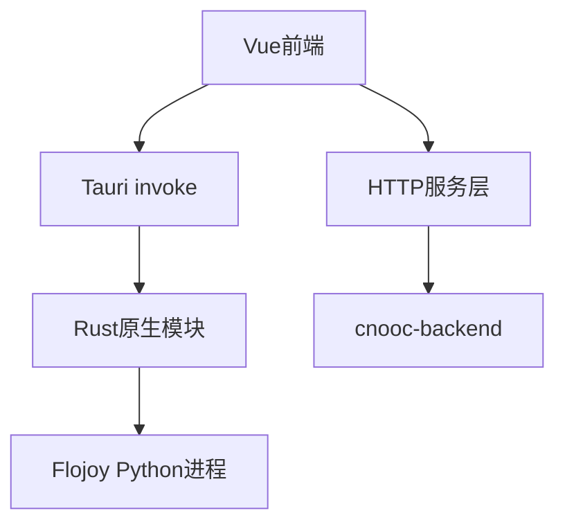

# COSL Operator 测试操作台软件 — 系统方案设计报告

**文档版本**：1.0  
**对应代码库**：`cosl-operator-tauri`  
**关联后端**：`cnooc-backend`（HTTP 服务）

---

## 1. 设计概述

COSL Operator 采用 **Tauri 2 + Vue 3 + TypeScript** 架构，实现测试操作台桌面化。  
前端负责业务流程、页面展示与配置管理；Rust 层负责摄像头、扫码、缓存、OCR、Flojoy 子进程等本地能力。

---

## 2. 总体架构

---

## 3. 分层设计

### 3.1 表现层

- 路由：`src/router/index.ts`
- 布局：`DefaultLayout`（头部、侧栏、内容区、底栏）
- 页面：测试台检测、视觉检测、工艺编辑、设置与报告预览

### 3.2 服务层

- `src/services/http.ts`：统一请求、超时、上传下载、错误处理
- `src/services/*`：订单、工艺、报告、工时与测试相关接口

### 3.3 组合层

- `useAuth`：登录、令牌管理、用户信息
- `useConfig`：配置持久化与跨窗口同步
- `useFlojoyBackend`：Python/Flojoy 环境与进程管理

### 3.4 原生层（Rust）

- `camera.rs`：摄像头能力
- `scanner.rs`：扫码枪能力
- `cache.rs`：缓存管理
- `flojoy.rs`：Flojoy 后端管理
- `ocr.rs`：OCR 识别

---

## 4. 界面原型与交互逻辑

### 4.1 主界面原型

- 顶部：窗口控制、主题切换、用户菜单、锁定
- 左侧：可折叠导航（仪表盘、测试台检测、视觉检测、工艺编辑）
- 中央：业务内容区（按路由切换）
- 底部：状态栏

### 4.2 关键交互

1. 登录成功后进入受保护路由，失败时保持登录页并提示。
2. 菜单点击切换业务页面，当前页面高亮显示。
3. 设置窗口变更配置后，主窗口同步刷新配置状态。
4. 关闭应用时自动清理 Flojoy 子进程，避免残留。

---

## 5. 数据与配置

- `auth.json`：Token 与用户信息
- `settings.json`：后端地址、主题、设备索引、离线参数、锁定密码哈希、Flojoy 配置
- 缓存由 Rust 层管理，用于离线数据和临时文件

---

## 6. 测试操作台页面设计要点

- 统一结构：订单/单元选择区、测试控制区、数据展示区、报告区
- 视觉页面：摄像头采集 + OCR/区域识别
- 工艺页面：步骤编辑 + 区域标注 + 参数配置
- 报告页面：预览、确认、提交

---

## 7. 非功能设计

- 性能：主窗口 1600×1000（最小 1024×700），流畅过渡动画
- 安全：Bearer Token、锁屏密码摘要存储、敏感操作确认
- 可靠性：配置持久化、进程退出清理、异常错误提示

---

## 8. 结论

该方案满足测试操作台桌面化、设备接入、流程可配置和报告闭环的设计目标。后续建议补充接口契约管理与自动化测试，以提升长期可维护性。

